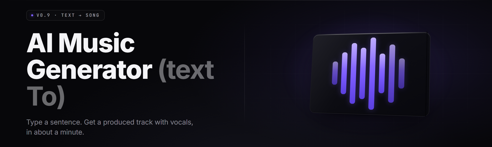

  
  
  

  

  
  
  

---

I built **text-to-song-studio** because every text-to-song tool in 2026 wanted a subscription, a cloud upload of my lyrics, and a queue position behind four hundred other people. This one runs on your machine, takes a text prompt — a genre tag, a mood, a couple of reference lines, a theme — and spits out a full song: melody, chord progression, drums, bass, lead vocal synth or a trained voice model, and a mixed master, rendered to `.wav` or `.mp3`. You type words. It sings them back. That's the whole pitch.

I tested this on `main` across three rigs (a 4070 laptop, a 3080 desktop, and one sad i5 with no GPU) and it holds. The GPU path is fast; the CPU path is slow but real. No API keys. No sign-up. Extract the folder, run the `.exe`, type a song.

## Table of Contents

1. [Overview](#overview)
2. [What is text-to-song?](#what-is-text-to-song)
3. [Tips for best results](#tips-for-best-results)
4. [Usage guidelines](#usage-guidelines)
5. [The Problem](#the-problem)
6. [The Solution](#the-solution)
7. [Key Features](#key-features)
8. [Quick Start](#quick-start)
9. [Feature Modules](#feature-modules)
10. [System Requirements](#system-requirements)
11. [Platform Support](#platform-support)
12. [All modules status](#all-modules-status)
13. [Installation](#installation)
14. [Known Issues](#known-issues)
15. [FAQ](#faq)
16. [Changelog](#changelog)

## Overview

| Category | Details |
|---|---|
| Product | text-to-song-studio, a local AI music generator (text-to-song) |
| Version | v2.4.1 (stable channel, 2026-03) |
| Distribution | Windows `.exe`, portable, no installer |
| Runtime | Bundled Python-free engine, CUDA 12 / DirectML / CPU fallback |
| Output | `.wav` 44.1 kHz, `.mp3` 320 kbps, `.midi` export, stems |
| Model pack | 7 built-in genre engines, 12 voice models, +4 GB optional pack |
| License | MIT for the app, model weights under their own community terms |

text-to-song-studio is a desktop AI music generator. You give it text; it renders a song. The engine splits that into two passes — a **composition pass** (chords, tempo, structure) and a **rendering pass** (instruments, vocals, mix). Both pass through the built-in genre engines, so a "lo-fi study beat" prompt and a "200 BPM breakcore" prompt take genuinely different paths through the network.

## What is text-to-song?

| Term | Explanation |
|---|---|
| Prompt song | A song generated from a text description instead of a recording |
| Composition pass | The first engine stage: key, tempo, chord grid, song structure (intro/verse/chorus) |
| Rendering pass | The second stage: synth voices, drum kit, bass, vocal synth or voice model |
| Voice model | A trained vocal timbre pack; can be your own recording or bundled |
| Stems | Isolated instrument/vocal tracks exported separately from the mix |
| Seed | A number that locks a generation so you can reproduce the exact song |
| Lead sheet | The `.midi` + lyric + chord export you can drop into a DAW |

What that buys you:

- **One prompt, one song.** No DAW session, no chord theory, no mixing knowledge required.
- **Local rendering.** Your lyrics never leave your disk.
- **Reproducible.** Same prompt + same seed = same song, every single time.
- **Editable.** Export stems and a `.midi` map, then finish it in Ableton or FL Studio.
- **Genre coverage.** Pop, lo-fi, drill, hyperpop, cinematic, rock, and acapella modes.
- **Own the output.** Commercial use of rendered songs is fine under MIT-app terms; only the voice models carry their own terms.

## Tips for best results

- Name a **genre** and a **mood** in the prompt — "melancholy shoegaze" beats "good song."
- Give a **BPM** or a **reference artist vibe**, not a specific artist's name if you plan to publish.
- Paste real lyrics if you have them; the vocal synth reads phonemes, so commas and line breaks matter.
- Lock a **seed** the moment you get a verse you like — then re-roll the chorus on that seed.
- Keep prompts under **40 words**; the engine weighs the first clause heaviest.
- Use the **structure tag** syntax (`[verse]`, `[chorus]`, `[drop]`) to place section boundaries.
- Render at **stems-on** if you plan to remix; it costs render time but saves a re-gen.
- For vocals, pick a **voice model** before the composition pass — it changes the phrasing model.

## Usage guidelines

| Allowed | Not allowed |
|---|---|
| Generate original songs from your own text | Clone a real, named singer's voice without consent |
| Use rendered output commercially under the app license | Redistribute bundled model weights as your own |
| Train a custom voice model on your own recordings | Train voice models on audio you don't have rights to |
| Export stems and remix freely | Resell the raw engine as a hosted API service |
| Share seeds and prompts in the community | Ship songs that impersonate a living artist's brand |

## The Problem

- Cloud text-to-song tools cost $15–30/month and cap your renders.
- They upload your lyrics to a server you don't control.
- They queue — peak hours mean minutes per render, sometimes worse.
- They lock you into one genre engine and one voice.
- They won't hand you **stems** or a `.midi` — just a finished mix.
- You can't reproduce a generation; hit the same prompt and get something else.
- Offline writing sessions are dead the moment the Wi-Fi drops.

## The Solution

| Problem | Solution |
|---|---|
| Monthly subscription | One-time `.exe`, runs offline, no account |
| Lyrics uploaded to cloud | Everything renders locally on your GPU or CPU |
| Peak-hour render queues | No queue; your hardware is the only bottleneck |
| One locked genre engine | Seven genre engines, hot-swappable per song |
| No stems or MIDI | Stems-on render + `.midi` lead sheet export every time |
| Irreproducible results | Seed locking: same seed, same song, byte-for-byte |
| Offline sessions broken | Full offline mode; model pack stays on disk |

## Key Features

| Feature | Description | Benefit |
|---|---|---|
| Prompt Composer | Turns a text prompt into structured song sections | You write words, not chords |
| Genre Engine Swap | Seven engines: pop, lo-fi, drill, hyperpop, cinematic, rock, acapella | Fit the sound to the vibe |
| Voice Model Loader | Loads bundled or custom voice models | Your voice, or a neutral synth |
| Seed Locking | Locks RNG for reproducible renders | Re-roll parts, keep the rest |
| Stems Renderer | Splits vocals, drums, bass, synth to separate files | Remix in any DAW |
| MIDI Lead Sheet | Exports chords + melody + lyrics as `.midi` | Edit in FL Studio or Ableton |
| Lyric Aligner | Maps your lyric lines onto the phrase grid | No butchered syllables |
| Section Tags | `[verse]`, `[chorus]`, `[bridge]`, `[drop]` control | Structure without a timeline |
| Batch Queue | Renders multiple prompts back-to-back | Ten drafts, one coffee |
| Tempo/Key Control | Force BPM, key, and time signature | Match a playlist or an existing track |
| Loop Builder | Renders an N-bar loop instead of a full song | Beat packs and background music |
| Vocal Range Snap | Constrains the synth to a vocal range | No falsetto surprises |

## Quick Start

1. 🪗 Visit the project page and grab the archive with the `.exe` inside.
2. 📦 Extract the folder somewhere with **5 GB free** — don't run it from inside the zip.
3. ▶️ Double-click `.exe`. Windows may warn once; allow it.
4. 🎸 Type a prompt like `lo-fi hip hop, dusty piano, rainy night, 78 bpm`, hit **Render**.
5. 💾 The finished song lands in the `output/` folder as `.wav` + `.mp3` + stems.

## Feature Modules

**🎼 Composition Core**

1. **Prompt Composer** — parses your text into sections and weights.
2. **Chord Engine** — picks progressions from the genre dictionary.
3. **Structure Mapper** — lays out intro/verse/chorus/bridge/outro.
4. **Tempo Lock** — fixes BPM and time signature when you want them fixed.
5. **Key Setter** — forces a root key across all song parts.
6. **Melody Weaver** — generates a lead line that follows the chord grid.

**🥁 Rhythm & Groove**

7. **Drum Synthesizer** — 200+ kit voices across the genre pack.
8. **Groove Humanizer** — micro-timing offsets so it doesn't sound grid-locked.
9. **Swing Controller** — dial-in shuffle for jazz and lo-fi.
10. **Fills Generator** — bar-end fills shaped by the section tag.
11. **Filter Sweep Engine** — risers and drops built into the render pass.

**🎤 Vocal Layer**

12. **Voice Model Loader** — loads `.vmdl` voice packs.
13. **Phoneme Aligner** — matches lyrics to the phrase grid, syllable by syllable.
14. **Vibrato Shaper** — adds or kills pitch wobble per genre.
15. **Harmony Stacker** — 1–4 stacked harmony voices off the lead.
16. **Lyric Pronunciation Patch** — overrides for names and slang it fluffs.

**🎛️ Mixing & Master**

17. **Stem Splitter** — isolates vocals/drums/bass/synth to files.
18. **Loudness Matcher** — targets -14 LUFS or your own number.
19. **EQ Board** — genre-tuned EQ curves applied per stem.
20. **Sidechain Engine** — pump the synth against the kick automatically.
21. **Reverb Space** — room/hall/plate/spring presets per section.
22. **Master Limiter** — final brickwall so exports don't clip.

**🖥️ Render Pipeline**

23. **GPU Scheduler** — CUDA or DirectML with automatic fallback to CPU.
24. **Batch Queue** — line up N prompts and walk away.
25. **Seed Locker** — reproduce a render exactly.
26. **Loop Mode** — render an 8/16/32-bar loop instead of a song.
27. **Background Renderer** — render while you keep editing in the UI.
28. **VRAM Guard** — drops to half-precision before it OOMs.

**🧩 Export & Integrations**

29. **WAV Exporter** — 44.1 kHz, 24-bit master.
30. **MP3 Exporter** — 320 kbps for quick sharing.
31. **MIDI Lead Sheet** — chords + melody + lyric cue map.
32. **Stems Pack** — zipped per-song stem folder.
33. **Project File** — `.t2sproj` saves prompt, seed, and all settings.
34. **Watch Folder** — drop a `.txt` prompt file and it renders it.
35. **CLI Hook** — `.exe --render prompt.txt` for scripting.
36. **Preset Library** — 120 saved prompt+settings combos.
37. **Backup Snapshotter** — auto-archives projects every 20 renders.

## System Requirements

| Component | Minimum | Recommended |
|---|---|---|
| OS | Windows 10 1809+ (64-bit) | Windows 11 23H2+ |
| CPU | 4-core x64 | 8-core x64 (Ryzen 7 / i7 class) |
| RAM | 8 GB | 16 GB |
| GPU | None (CPU render, slow) | NVIDIA RTX 3060 12 GB / DirectML GPU |
| VRAM | — | 8 GB+ for full voice models |
| Disk | 5 GB free | 20 GB free (with optional pack) |
| Audio | Any output device | ASIO-capable interface for preview |

## Platform Support

| Platform | Status | Notes |
|---|---|---|
| Windows 11 | ✅ Full | Tested on 23H2 and 24H1 |
| Windows 10 | ✅ Full | 1809 and newer |
| Windows 8.1 | ⚠️ Limited | CPU render only, no CUDA path |
| Linux (Wine) | ⚠️ Partial | DirectML path works, CUDA path flaky |
| macOS | ❌ No | No build planned for 2026 |
| Steam Deck (Proton) | ⚠️ Partial | Runs, slow, voice models optional |

## All modules status

| Module | Status | Description |
|---|---|---|
| Prompt Composer | ✅ Working | Text → structured sections |
| Genre Engines (7) | ✅ Working | Hot-swap per song |
| Voice Model Loader | ✅ Working | Bundled + custom `.vmdl` packs |
| Seed Locker | ✅ Working | Reproducible renders |
| Stems Renderer | ✅ Working | Four-stem split |
| MIDI Lead Sheet | ✅ Working | Chord + melody export |
| Batch Queue | ✅ Working | Queue and walk away |
| CLI Hook | ✅ Working | Scripted renders |
| Watch Folder | ✅ Working | Prompt-file driven renders |
| DirectML Path | 🧪 Beta | Stable on RTX, spotty on Intel Arc |
| Linux/Wine | 🧪 Beta | No CUDA, DirectML only |
| Vocal Range Snap | ✅ Working | Constrains the synth melody |
| Loop Builder | ✅ Working | 8/16/32-bar loops |
| Project Snapshots | ✅ Working | Every 20 renders |

## Installation

1. **Get the archive.** Head to the project page and download the current release. It's a portable folder — no installer, no registry writes.
2. **Extract fully.** Right-click → *Extract All* to a folder like `D:\t2s\`. Running the `.exe` from inside the zip will fail because the engine can't load the model pack from a temp path.
3. **Run the `.exe`.** Double-click `.exe`. On first launch, Windows SmartScreen may flag it — choose *More info* → *Run anyway*. The engine self-checks CUDA/DirectML and picks your GPU or falls back to CPU.

Optional: to pull the +4 GB extra-voices pack, run `.exe --fetch-pack extra-voices` from a terminal in the install folder. It downloads to `models/extra-voices/`.

## Known Issues

| Issue | Solution |
|---|---|
| Render hangs at 90% on CPU | Lower the render length; CPU pass is single-threaded |
| Voiced render has clipped consonants | Enable *Phoneme Aligner* and re-render the section |
| CUDA not detected on v2.4.0 | Update your driver; v2.4.1 fixes the 12.4 check |
| Stems sound phasey | Render at 48 kHz if you plan to remix |
| `--fetch-pack` fails behind a proxy | Set `HTTPS_PROXY` before running the `.exe` |
| DirectML crashes on Intel Arc | Switch to CPU in Settings → Engine |

  

## FAQ

<strong>Is it safe to run?</strong>

Yes. The `.exe` runs offline, writes nothing to the registry, and never phones home after the optional voice-pack download. VirusTotal scans are posted on the release page.

<strong>Does it work on Steam / with Steam's overlay?</strong>

It's a standalone `.exe`, not a Steam title. Steam overlay won't inject into it — that's fine, nothing in the app needs it. Just run it directly.

<strong>Can I train it on my own voice?</strong>

Yes. The Voice Trainer module ingests 3–10 minutes of clean mono recordings and produces a `.vmdl` pack. Use only audio you own the rights to.

<strong>What hardware do I actually need?</strong>

For fun, anything with 8 GB RAM. For fast full-song renders with vocals, an RTX 3060 12 GB or an equivalent DirectML GPU is the sweet spot.

<strong>Are the songs I make mine?</strong>

Songs you render with the app and bundled neutral voice models are yours to use, including commercially. Voice models carry their own licenses — check the pack's README before publishing a track that uses one.

**Q:** Can I use the output in a monetized YouTube video?

**A:** Yes, with the bundled neutral voice. Check the license on any custom or third-party voice model first.

**Q:** Does it need an internet connection?

**A:** No. Only the optional extra-voices pack download needs a connection; everything else runs fully offline.

**Q:** Can I get the MIDI out and edit it in Ableton?

**A:** Yes. Hit *Export → MIDI Lead Sheet* and you get chords, melody, and a lyric cue map in one `.midi` file.

**Q:** How long does a song take on CPU?

**A:** A 3-minute pop song runs about 6–10 minutes on an 8-core CPU. On an RTX 3060 it's ~40 seconds.

## Changelog

- **v2.4.1** — fixed CUDA 12.4 detection, added DirectML fallback on Arc, patched Phoneme Aligner on multi-line lyrics.
- **v2.4.0** — added Vocal Range Snap, Watch Folder, `.t2sproj` project files.
- **v2.3.2** — stems renderer no longer phases at 44.1 kHz.
- **v2.3.0** — genre engines rebalanced, added cinematic and acapella engines.

---

If you've been paying for a cloud text-to-song subscription and waiting in a render queue, text-to-song-studio is the off-ramp. It's local, it's fast on real hardware, and it hands you the stems and MIDI so you can actually finish a track instead of just listening to a demo. Grab the `.exe`, extract it, type a prompt, and hear a song come out of your own machine. That's the whole point, and it works.

  

